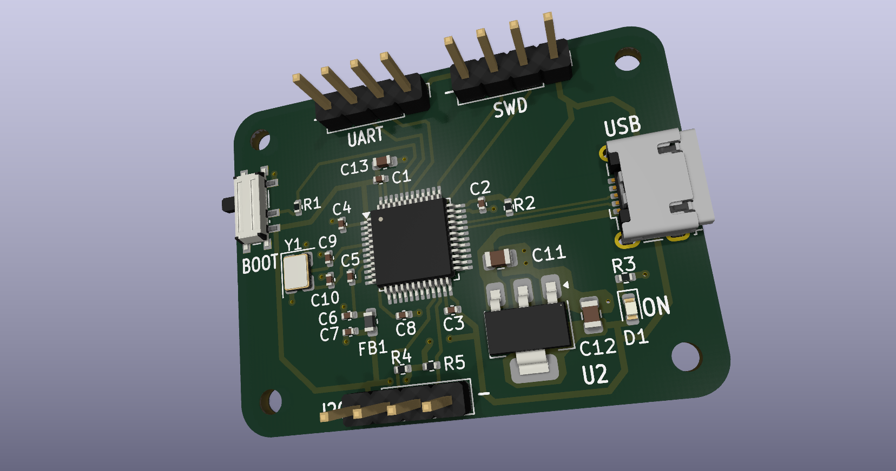
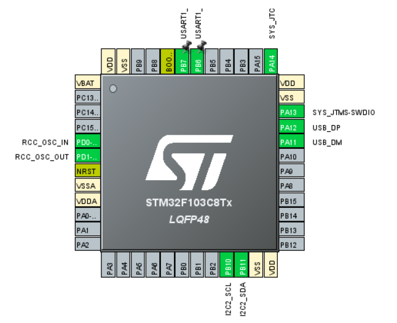
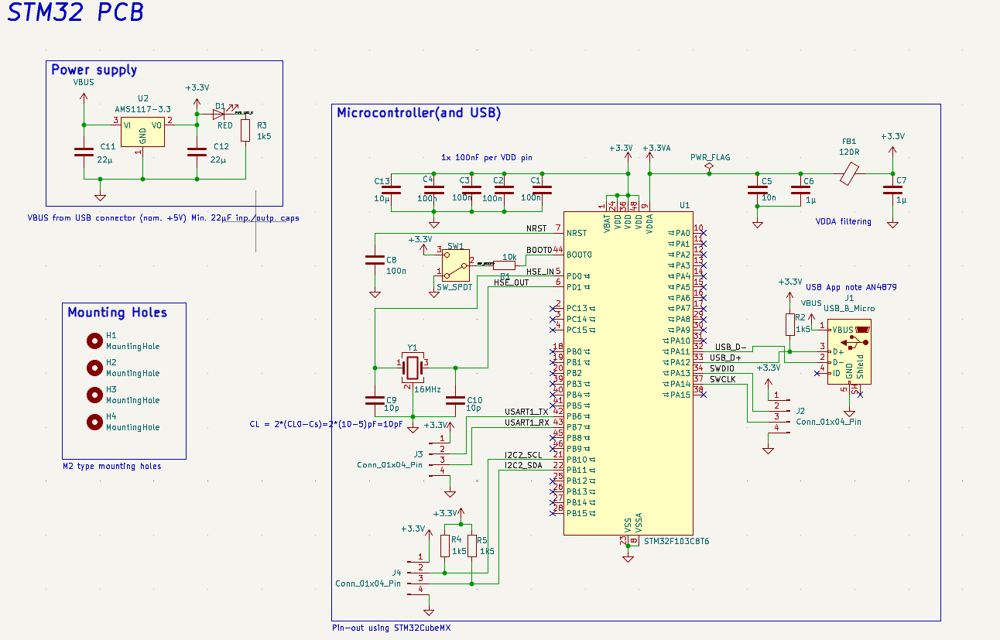
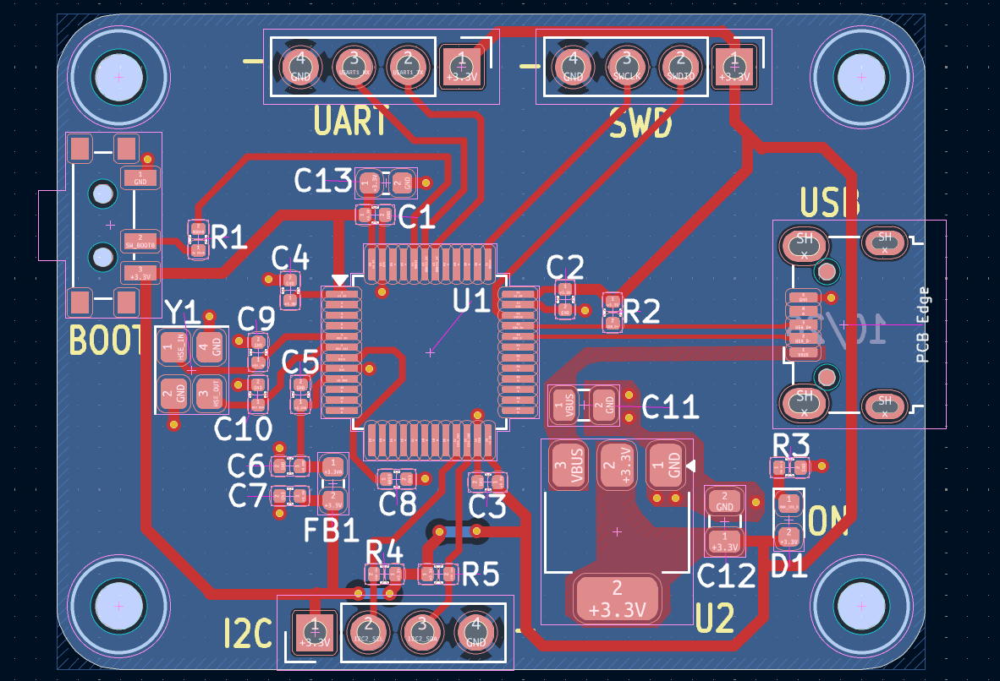

# STM32 Development Board

A compact 2-layer development board based on the STM32F103C8T6 microcontroller, designed in KiCad.
Designed during my Master's as a hands-on project in microcontroller hardware and PCB design.

**Status:** Hardware design complete. 

## Features
- **MCU:** STM32F103C8T6 (Arm Cortex-M3, 72 MHz, 64 KB Flash, 20 KB SRAM, LQFP48)
- **USB:** Micro-B connector for 5 V power and USB full-speed device (1.5 kΩ pull-up on D+)
- **Power:** AMS1117-3.3 LDO regulator (5 V USB input → 3.3 V)
- **Clock:** 16 MHz HSE crystal with 10 pF load capacitors
- **Analog supply:** VDDA filtered with a 120 Ω ferrite bead and decoupling capacitors
- **Programming:** SWD header (3V3, SWDIO, SWCLK, GND)
- **Boot mode:** BOOT0 slide switch to select the built-in bootloader
- **Interfaces:** UART and I2C headers (with 1.5 kΩ I2C pull-ups)
- **Indicators:** Red power LED
- **Mechanical:** 4 × M2 mounting holes

## MCU Pinout
| Function | Pins |
|---|---|
| SWD | PA13 (SWDIO), PA14 (SWCLK) |
| HSE crystal | PD0 (OSC_IN), PD1 (OSC_OUT) |
| USB | PA11 (D−), PA12 (D+) |
| USART1 | PB6 (TX), PB7 (RX) |
| I2C2 | PB10 (SCL), PB11 (SDA) |

## Schematic

## PCB Layout

## Design Process
1. **Pin planning:** configured SWD, HSE crystal, USB, UART and I2C in STM32CubeMX
2. **Schematic:** MCU with 100 nF decoupling per supply pin plus bulk capacitance, ferrite-bead filtered VDDA, crystal load capacitors calculated from the crystal's load capacitance and estimated stray capacitance, USB D+ pull-up, LDO with input/output capacitors, BOOT0 switch
3. **ERC:** electrical rules check passed
4. **Footprint assignment:** 0402/0603/0805 SMD passives, 3D model added for the USB connector
5. **PCB layout:** 2-layer board, solid ground plane on the bottom layer, decoupling capacitors placed close to each supply pin, crystal and load capacitors placed close to the MCU
6. **Routing:** USB D+/D− routed as a short differential pair, 0.3 mm signal traces, 0.5 mm power traces, ground vias and copper pours around the regulator
7. **DRC:** design rules check passed against the manufacturer's capabilities
8. **Fabrication outputs:** Gerbers, drill file, BOM and component placement file

## Programming Interface
- **SWD:** connect an ST-Link to the SWD header for programming and debugging.
- **Bootloader:** set BOOT0 high, reconnect power, then flash. Set BOOT0 back low to run the program.

## Repository Contents
| Folder | Contents |
|---|---|
| `Hardware/` | KiCad project, schematic, PCB and custom footprint library |
| `Firmware/stm32_pinout/` | STM32CubeMX pin configuration (`stm32_pinout.ioc`) |
| `Fabrication/` | Gerber files, drill file, BOM, placement file, schematic PDF |
| `images/` | Renders and screenshots |

## Tools
- KiCad 6.0
- STM32CubeIDE / STM32CubeMX

## References
- [STM32F103C8 product page and datasheet](https://www.st.com/en/microcontrollers-microprocessors/stm32f103c8.html)
- ST AN2867: Oscillator design guide for STM32 MCUs
- ST AN4879: USB hardware and PCB guidelines using STM32 MCUs